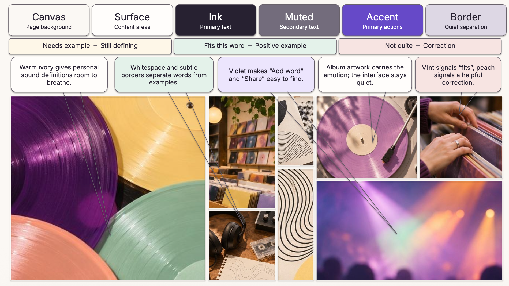
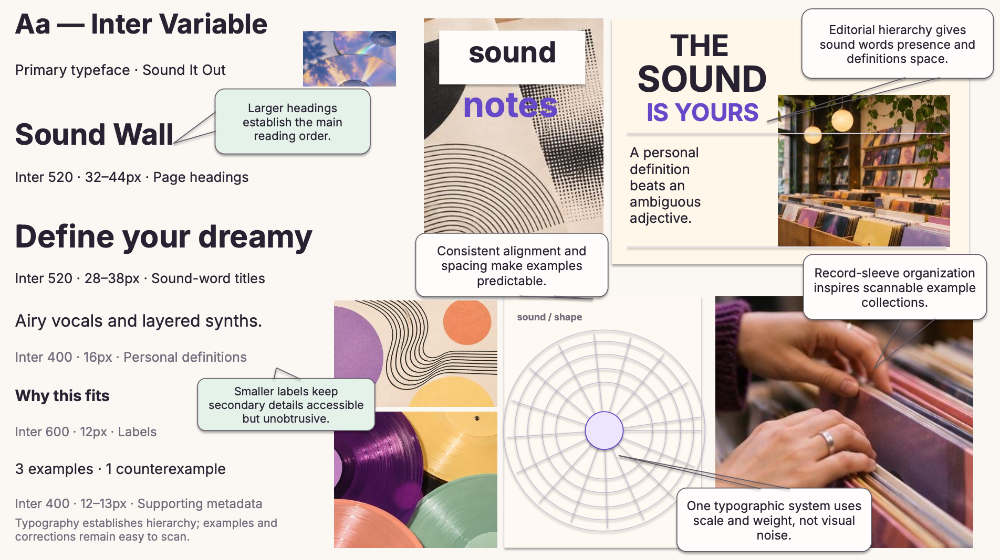

# Problem Framing

[Read the revised problem framing and ethical analysis](f2.md). Friends can resolve what a word such as “dreamy” means through examples and conversation, but that explanation can be scattered across messages and difficult to reuse. Sound It Out collects a listener’s definition, examples, and optional feedback in one editable entry.

# Concept Design

The interface calls each personal definition a **word**; its concept identity is an `Association`. A sound example is an `Excerpt` plus an `Annotation` explaining its role in that particular word. A `Pitch` is a proposal and its owner’s review, kept separate from accepted examples. This distinction lets Alex and Daniel reference the same sound without sharing its meaning or accepting each other's judgment.

```text
Track + interval ──> Excerpt ──> Annotation ──> Association
                         └─────> Pitch ────────> Association
                                   │
                            owner may promote ──> Annotation
```

Each concept has one job:

- **Associating** keeps Alex's meaning of “hype” separate from Daniel's.
- **Excerpting** identifies a track interval without assigning it a meaning.
- **Annotating** explains why that interval fits a particular word.
- **Pitching** records a suggestion and the owner’s review, without adding it to the accepted examples.
- **UserAuthenticating** checks credentials so the application can identify who is acting.

To add an example, the application selects an excerpt and annotates it for Alex's association. To suggest one, it selects an excerpt and creates a pitch instead. Alex can review the pitch and, in a separate step, promote a match into a private annotation. This separation preserves human judgment: the same sound can illustrate different meanings, and no suggestion becomes an example without its owner's decision.

## Associating

### Purpose

Give a person an editable, independent definition of a subjective label.
*Prevents:* One person's interpretation replacing another's; ambiguity about which definition belongs to whom; accidental duplication of the same label within one person's vocabulary.

### Principle

Alex defines "hype" as music with energetic percussion and a driving rhythm, but not necessarily loud vocals. A friend can independently define "hype" as fast electronic dance music. Each person retains their own definition. Alex can revise the description as their understanding changes or remove the word when it is no longer useful. Changing Alex's definition never changes the friend's definition.

### Types

```types
external User
  An opaque identity representing the person defining a label.
```

### State

```state
Visibility is PRIVATE or PUBLIC

a set of Associations with
  a user User
  a label String
  a description String
  a visibility Visibility
  unique user and normalized label

Rule: Labels are normalized for comparison by trimming surrounding whitespace, collapsing internal whitespace, and converting to lowercase. The displayed label preserves the user's chosen capitalization.
Rule: An association has a stable identity that does not change when its description is edited. New associations are PRIVATE by default in the application.
```

### Actions

```actions
associate(user: User, label: String, description: String, visibility: Visibility) : returns (association: Association)
  where the normalized label is empty or the trimmed description is empty
  then
    refuses INVALID_ASSOCIATION "Provide a word and a description."
  where an association already exists for the user and normalized label
  then
    refuses ASSOCIATION_EXISTS "You have already defined this word."
  where the normalized label and trimmed description are not empty and no association exists
  then
    create an association with the user, trimmed label, trimmed description, and visibility
    returns the new association

update(user: User, association: Association, description: String) : returns ()
  where the association does not exist
  then
    refuses UNKNOWN_ASSOCIATION "This word could not be found."
  where the association belongs to a different user
  then
    refuses NOT_OWNER "You cannot edit another user's definition."
  where the trimmed description is empty
  then
    refuses INVALID_DESCRIPTION "Provide a description."
  where the association exists, belongs to the user, and the description is valid
  then
    replace the association's description with the trimmed description
    returns

setVisibility(user: User, association: Association, visibility: Visibility) : returns ()
  where the association does not exist
  then
    refuses UNKNOWN_ASSOCIATION "This word could not be found."
  where the association belongs to a different user
  then
    refuses NOT_OWNER "You cannot edit another user's definition."
  where the association exists and belongs to the user
  then
    set its visibility to the supplied value
    returns

remove(user: User, association: Association) : returns ()
  where the association does not exist
  then
    refuses UNKNOWN_ASSOCIATION "This word could not be found."
  where the association belongs to a different user
  then
    refuses NOT_OWNER "You cannot remove another user's definition."
  where the association exists and belongs to the user
  then
    remove the association
    returns
```

### Queries

```queries
_byUser(user: User) : many (association: Association, label: String, description: String, visibility: Visibility)
  Returns every association defined by the given user.

_get(association: Association) : optional (user: User, label: String, description: String, visibility: Visibility)
  Returns the association's owner and definition, or no result if the association does not exist.
```

**Note.** Uniqueness is per person and normalized word, so two listeners can use the same word without competing for a single definition. Public visibility applies to the definition alone; examples have their own visibility.


## Excerpting

### Purpose

Make a selected portion of a longer media item independently identifiable and reproducible.
*Prevents:* Listeners having to search through a full song to find the relevant moment; uncertainty about which section a contributor intended; two identical selections being treated as unrelated excerpts.

### Principle

Alex selects the interval from 42 to 57 seconds of a song because it contains the percussion that makes the song feel "hype." The excerpt identifies that interval without assigning it a meaning. A friend may reference the same interval for an entirely different purpose. Selecting an already existing interval returns its existing identity, so examples can refer to the same sound without duplicating its definition.

### Types

```types
external Track
  An opaque identity representing a media item supplied by an external catalog.
```

### State

```state
a set of Excerpts with
  a track Track
  a startMs Number
  a endMs Number
  unique track and startMs and endMs

Rule: 0 <= startMs < endMs
Rule: Time positions are measured in milliseconds. The application checks the end against track duration when reliable duration metadata is available; otherwise it communicates that the interval cannot be verified.
```

### Actions

```actions
select(track: Track, startMs: Number, endMs: Number) : returns (excerpt: Excerpt)
  where either position is non-finite, negative, or not a whole number, or startMs >= endMs
  then
    refuses INVALID_RANGE "Select a valid portion of the track."
  where an excerpt already exists for the same track and boundaries
  then
    returns the existing excerpt without changing state
  where the range is valid and no excerpt exists for the track and boundaries
  then
    create an excerpt with the supplied track and boundaries
    returns the new excerpt
```

### Queries

```queries
_get(excerpt: Excerpt) : optional (track: Track, startMs: Number, endMs: Number)
  Returns the track and interval represented by an excerpt, or no result if the excerpt does not exist.
```

**Note.** An excerpt identifies an interval; it does not copy audio or assign meaning. Reusing the same identity allows the interval to appear in several contexts. Provider playback and duration verification remain external constraints.


## Annotating

### Purpose

Preserve an explanation of how an item relates to a particular context.
*Prevents:* Examples being presented without their intended meaning; the same item having an unexplained role in different contexts; private explanations becoming visible merely because their associated context was shared.

### Principle

Alex associates "hype" with energetic percussion. They attach an excerpt of a song with the note, "The drums build energy without the vocals becoming overwhelming." Alex can also attach a counterexample. The item remains the same in both cases. The annotation records how it should be interpreted in this particular context. Alex can revise the explanation, change the item's role, or remove it.

### Types

```types
external Author
  An opaque identity representing the person responsible for the annotation.
external Item
  An opaque identity representing the item being explained.
external Context
  An opaque identity representing the setting in which the explanation applies.
```

### State

```state
Role is EXAMPLE or COUNTEREXAMPLE
Visibility is PRIVATE or SHARED

a set of Annotations with
  an author Author
  an item Item
  a context Context
  a role Role
  a note String
  a visibility Visibility
  unique context and item

Rule: New annotations are PRIVATE.
```

### Actions

```actions
annotate(author: Author, item: Item, context: Context, role: Role, note: String) : returns (annotation: Annotation)
  where the trimmed note is empty
  then
    refuses INVALID_NOTE "Explain why this example matters."
  where an annotation already exists for the item and context
  then
    refuses ANNOTATION_EXISTS "This item is already included here."
  where the note is valid and no annotation exists for the item and context
  then
    create an annotation with the supplied author, item, context, role, trimmed note, and PRIVATE visibility
    returns the annotation

update(author: Author, annotation: Annotation, role: Role, note: String) : returns ()
  where the annotation does not exist
  then
    refuses UNKNOWN_ANNOTATION "This annotation could not be found."
  where the annotation belongs to another author
  then
    refuses NOT_AUTHOR "You cannot edit another user's annotation."
  where the trimmed note is empty
  then
    refuses INVALID_NOTE "Explain why this example matters."
  where the annotation exists, belongs to the author, and the note is valid
  then
    update the role and note, preserving the annotation's identity and visibility
    returns

setVisibility(author: Author, annotation: Annotation, visibility: Visibility) : returns ()
  where the annotation does not exist
  then
    refuses UNKNOWN_ANNOTATION "This annotation could not be found."
  where the annotation belongs to another author
  then
    refuses NOT_AUTHOR "You cannot edit another user's annotation."
  where the annotation exists and belongs to the author
  then
    set its visibility to the supplied value
    returns

remove(author: Author, annotation: Annotation) : returns ()
  where the annotation does not exist
  then
    refuses UNKNOWN_ANNOTATION "This annotation could not be found."
  where the annotation belongs to another author
  then
    refuses NOT_AUTHOR "You cannot remove another user's annotation."
  where the annotation exists and belongs to the author
  then
    remove the annotation
    returns

clearContext(context: Context) : returns ()
  where true
  then
    remove all annotations for the supplied context
    returns
```

### Queries

```queries
_forContext(context: Context) : many (annotation: Annotation, author: Author, item: Item, role: Role, note: String, visibility: Visibility)
  Returns the annotations belonging to a particular context.
```

**Note.** The same excerpt can mean different things in different contexts. Uniqueness is per context and item, so an owner edits an existing annotation rather than adding a conflicting second role.


## Pitching

### Purpose

Let a contributor propose an item for consideration and let the recipient record a private, revisable response to that proposal.

### Principle

Daniel proposes a song interval for Alex's “hype.” The pitch is pending until Alex reviews it. Alex marks it a partial match and notes that the drums fit but the vocals are too intense. This response is private unless Alex shares it with Daniel. If Daniel changes his mind before the review, he can withdraw the pitch. A review does not itself add the song to Alex's examples.

### Types

```types
external Contributor
external Target
external Item
```

### State

```state
Fit is PENDING or MATCH or PARTIAL or MISS
Visibility is PRIVATE or PUBLIC

a set of Pitches with
  a contributor Contributor
  a target Target
  an item Item
  a visibility Visibility
  a fit Fit
  a response String
  a responseShared Flag
  unique target and item

Rule: A new pitch is PENDING, with an empty response and responseShared false.
Rule: A PENDING pitch has an empty response and responseShared false.
Rule: A new or changed review is private, even if the previous review was shared.
```

### Actions

```actions
pitch(contributor: Contributor, target: Target, item: Item, visibility: Visibility) : returns (pitch: Pitch)
  where a pitch already exists for target and item
  then
    refuses ALREADY_PITCHED "This item has already been pitched here."
  where no pitch exists for target and item
  then
    create a pitch with contributor, target, item, visibility,
      PENDING fit, empty response, and responseShared false
    returns the pitch

withdraw(contributor: Contributor, pitch: Pitch) : returns ()
  where the pitch does not exist
  then
    refuses UNKNOWN_PITCH "This pitch could not be found."
  where the pitch belongs to another contributor
  then
    refuses NOT_CONTRIBUTOR "You cannot withdraw someone else's pitch."
  where the pitch has already been reviewed
  then
    refuses ALREADY_REVIEWED "This pitch has already been reviewed."
  where the pitch exists, belongs to contributor, and is PENDING
  then
    remove the pitch
    returns

review(pitch: Pitch, fit: Fit, response: String) : returns ()
  where the pitch does not exist
  then
    refuses UNKNOWN_PITCH "This pitch could not be found."
  where fit is PENDING
  then
    refuses INVALID_REVIEW "Choose a fit."
  where the pitch exists and fit is not PENDING
  then
    set its fit to fit and response to the trimmed response
    set responseShared to false
    returns

setVisibility(contributor: Contributor, pitch: Pitch, visibility: Visibility) : returns ()
  where the pitch does not exist
  then
    refuses UNKNOWN_PITCH "This pitch could not be found."
  where the pitch belongs to another contributor
  then
    refuses NOT_CONTRIBUTOR "You cannot change someone else's pitch."
  where the pitch exists and belongs to contributor
  then
    set its visibility to visibility
    returns

setResponseShared(pitch: Pitch, shared: Flag) : returns ()
  where the pitch does not exist
  then
    refuses UNKNOWN_PITCH "This pitch could not be found."
  where the pitch is PENDING and shared is true
  then
    refuses NOT_REVIEWED "There is no review to share."
  where the pitch exists and either it has been reviewed or shared is false
  then
    set responseShared to shared
    returns

clearTarget(target: Target) : returns ()
  where true
  then
    remove all pitches for target
    returns
```

### Queries

```queries
_get(pitch: Pitch) : optional (contributor: Contributor, target: Target, item: Item, visibility: Visibility, fit: Fit, response: String, responseShared: Flag)
  Returns the pitch's fields, or no result if it does not exist.

_forTarget(target: Target) : many (pitch: Pitch, contributor: Contributor, item: Item, visibility: Visibility, fit: Fit, response: String, responseShared: Flag)
  Returns all pitches for target.
```

**Note.** The review belongs to the proposal's lifecycle: without a pitch there is nothing to review. `Pitching` does not create accepted examples or determine who owns a target; the application checks the owner before allowing a review or sharing its response. A review response explains a judgment to the contributor, while an `Annotation` explains an accepted example in the owner's definition. One pitch per target and item prevents duplicate proposals, but a second contributor cannot propose that same interval for the target while the first pitch exists.


## UserAuthenticating

### Purpose

Let people come back to their account by proving who they are with a password.
*Prevents:* someone signs in with a password other than the one set for that user; someone replaces the password of an account that already has one; someone who reads the stored data learns a person's password.

### Principle

Ben sets a password when he signs up, and the next day he authenticates with it. Leo guesses at Ben's password and is refused with "The username or password is incorrect." Leo then tries to set a new password for Ben, and is refused with "This account already has a password."

### Types

```types
external User
  The person a password belongs to.
```

### State

```state
opaque Secret

a set of Users with
  a verifier Secret

Rule: Each User has at most one verifier.
Rule: Authenticating stores only a verifier derived from the password, never the password itself.
```

### Actions

```actions
set(user: User, password: String) : returns (user: User)
  where password is shorter than 8 or longer than 128 characters
  then
    refuses INVALID_PASSWORD "A password must have 8 to 128 characters."
  where user already has a verifier
  then
    refuses PASSWORD_SET "This account already has a password."
  where password is accepted and user has no verifier
  then
    add user with a verifier derived from password
    returns user

authenticate(user: User, password: String) : returns (user: User)
  where user has no verifier, or password does not match it
  then
    refuses INVALID_CREDENTIALS "The username or password is incorrect."
  where password matches the user's verifier
  then
    returns user
```

### Queries

```queries
_acceptable(password: String) : one (acceptable: Flag)
  Returns true when the password has 8 to 128 characters, and false otherwise.
```

**Note.** This concept verifies credentials; the application creates identities and establishes sessions separately. Password reset, rate limiting, and account recovery remain implementation concerns that must be resolved before deployment.

### Application access and coordination rules

All action alternatives are evaluated in the order written; the first matching refusal or success applies, and refusals leave state unchanged. Concept queries describe internal state, not unrestricted public endpoints. An authenticated request identifies its actor; the application checks ownership through `Associating._get` before invoking owner-only operations. Only the association owner may add, edit, share, or remove its annotations; review pitches; or share a review. Only a pitch's contributor may withdraw it or change its visibility. Cleanup actions are internal and run only after successful owner-authorized deletion. The owner can see all pitches for their association; a contributor can see their own pitch, but sees its review only when `responseShared` is true. Other viewers see neither private pitches nor reviews. A public association exposes only annotations marked SHARED; private associations and annotations are visible only to their owner. Public means accessible to anyone with the address, not a revocable, secret link.

Registration creates a fresh user identity and sets its password as one atomic operation; callers cannot choose an existing identity or directly invoke `UserAuthenticating.set`. A successful authentication establishes a session, from which protected requests obtain their actor; a client-supplied user identity is never treated as proof of identity. A friend must sign in to submit a pitch in the initial version; viewing a public association needs no account. The application verifies that the target exists and is public before accepting a pitch, and that an annotation's author owns its context. These checks protect concept actions that deliberately use generic external identities. The application maintains these cross-concept invariants: every annotation and pitch targets an existing association; only an association owner may create an annotation for it; and a pitch never creates an annotation without the owner’s explicit promotion. Requests involving multiple concepts are atomic: if any required action refuses, none of that request's state changes persist. A refused add or proposal does not leave a newly selected excerpt behind. Review and promotion are separate requests: a failed promotion leaves the saved review unchanged. Cleanup on deletion is part of the same transaction, serialized against concurrent additions to that association. Withdrawal is likewise serialized against review, so a pitch cannot be reviewed after it has been withdrawn. This atomicity is an implementation requirement to verify, not a claim about an existing system. A review can be updated later; changing a review does not automatically remove an already promoted example, which the owner can edit or remove separately.


## Essential Reactions

Sound It Out instantiates `Annotating.Item` and `Pitching.Item` as excerpts, and `Annotating.Context` and `Pitching.Target` as associations. `Contributor`, `Author`, and `User` denote the same authenticated user identities. `Requesting` below is the application request interface, not a persistent domain concept: each named action represents one incoming request carrying the listed arguments and a server-established actor. For the request types shown, a request that fails its authorization or other guards is refused, not silently accepted. Other protected operations follow the access rules above. Reactions correlate actions by request identity; variables in a reaction refer to the same request and its results.

### Add an example

```text
reaction selectExample
when Requesting.addExample(actor, association, track, startMs, endMs, role, note)
where Associating._get(association) returns (user: actor, ...)
then Excerpting.select(track, startMs, endMs)

reaction annotateExample
when Requesting.addExample(actor, association, track, startMs, endMs, role, note)
     Excerpting.select(track, startMs, endMs) returns (excerpt)
where Associating._get(association) returns (user: actor, ...)
then Annotating.annotate(actor, excerpt, association, role, note)
```

**Note.** The request and selection must belong to the same transaction. The owner and context are passed explicitly; the same track interval may be reused elsewhere with a different annotation.

### Propose an excerpt

```text
reaction selectProposal
when Requesting.propose(actor, association, track, startMs, endMs, visibility)
where actor is authenticated
      Associating._get(association) returns (visibility: PUBLIC, ...)
then Excerpting.select(track, startMs, endMs)

reaction pitchProposal
when Requesting.propose(actor, association, track, startMs, endMs, visibility)
     Excerpting.select(track, startMs, endMs) returns (excerpt)
where actor is authenticated
      Associating._get(association) returns (visibility: PUBLIC, ...)
then Pitching.pitch(actor, association, excerpt, visibility)
```

**Note.** Selecting an excerpt does not accept it. The contributor, target, and item are all recorded by `pitch`; only the owner can later promote it. The visibility argument belongs to the pitch, not the target.

### Review a pitch

```text
reaction reviewPitch
when Requesting.review(actor, pitch, fit, response)
where Pitching._get(pitch) returns (target: association, ...)
      Associating._get(association) returns (user: actor, ...)
then Pitching.review(pitch, fit, response)
```

**Note.** Only the target's owner can review. Any new or edited review starts private; sharing it requires a separate owner action.

### Promote a reviewed match

```text
reaction promotePitch
when Requesting.promote(actor, pitch, exampleNote)
where Pitching._get(pitch) returns (target: association, item: excerpt, fit: MATCH, ...)
      Associating._get(association) returns (user: actor, ...)
then Annotating.annotate(actor, excerpt, association, EXAMPLE, exampleNote)
```

**Note.** Promotion requires an existing MATCH, an owner, and a nonempty example note. The annotation begins private. If it already exists or the note is invalid, `annotate` refuses and the saved review remains unchanged. A later change to the review does not delete an accepted example; the owner controls that annotation separately.

### Remove a word and its dependent records

```text
reaction removeWord
when Requesting.removeWord(actor, association)
where Associating._get(association) returns (user: actor, ...)
then Associating.remove(actor, association)

reaction removeAnnotations
when Associating.remove(user, association) succeeds
then Annotating.clearContext(association)

reaction removePitches
when Associating.remove(user, association) succeeds
then Pitching.clearTarget(association)
```

**Note.** These reactions remove annotations and pitches, including their reviews, in the deletion transaction. Excerpts remain available for other words. Recreating the same label produces a new association identity and cannot inherit the deleted word's pitches or annotations.

### Representative access checks

```text
reaction withdrawPitch
when Requesting.withdraw(actor, pitch)
where Pitching._get(pitch) returns (contributor: actor, fit: PENDING, ...)
then Pitching.withdraw(actor, pitch)


reaction shareReview
when Requesting.shareReview(actor, pitch, shared)
where Pitching._get(pitch) returns (target: association, ...)
      Associating._get(association) returns (user: actor, ...)
then Pitching.setResponseShared(pitch, shared)
```

**Note.** These illustrate the access patterns for contributor-only and owner-only actions. The contributor alone may withdraw or change the visibility of a pitch, and annotation edits require both ownership of the association and authorship of the annotation. Cleanup actions are internal. Query projections enforce the same visibility rules: a public association exposes only shared annotations; a contributor sees a review only when shared. An address to a public association is forwardable and is not a secret link.

# User Journey

Alex wants fresh music for their commute and asks Daniel for something “hype.” He sends fast electronic tracks. Alex was hoping for driving drums without overpowering vocals, but “not quite hype” does not tell Daniel what to change.

Alex creates a private “hype” entry in Sound It Out and describes it as “driving percussion without overpowering vocals.” They choose a familiar song from the catalog and mark the passage from 0:42 to 0:57. Beside it, they write: “The drums build energy while the vocals stay in the background.” If the music provider cannot play that exact interval, the entry shows the timestamps and a link to the track.

Alex previews the entry, shares the example, and makes the word public. Daniel opens its address without an account. The description and passage give him a more specific starting point than “hype” alone. He signs in, chooses a song and passage of his own, and submits a pitch. It appears in Alex's review queue, separate from their examples.

Alex listens and marks the pitch **partial match**: “The drums fit, but the vocals are more intense than I wanted.” The assessment stays private unless Alex chooses to share it with Daniel. A later pitch is a match. Alex saves that judgment, then chooses to promote the pitch and writes why it fits. The new example starts private; Alex shares it when ready.

The next time Alex asks a friend for this kind of music, they can send the updated entry instead of rebuilding the explanation from a chat. If their taste changes, they can edit the word or make it private again. The journey illustrates a possibility to test: whether one passage and a short explanation help a friend make a more useful suggestion.

# Visual Design Study





Sound It Out should feel like exploring a personal record collection: expressive enough to reflect someone's musical taste, but organized enough that another person can understand it without explanation. Our visual study draws from vinyl artwork, independent music magazines, record-store displays, and editorial typography. These references suggest a design in which music supplies the personality while the interface provides a clear structure for understanding it.

The central challenge is distinguishing what a listener means, which songs demonstrate that meaning, and what other people have suggested. Our visual choices make these relationships visible without requiring users to inspect every song or read every explanation.

### 1. Color Study — Expressive Music, Quiet Interface

Our palette combines warm, paper-like backgrounds with deep plum text and a focused violet accent. The references use vibrant records, concert lighting, and textured print design, but we deliberately avoid applying that intensity to every interface element.

| Role | Color | Application | 
| ----- | ----- | ----- | 
| Canvas | `#FBF8F4` | Warm background for the Sound Wall | 
| Surface | `#FFFDFB` | Word entries, examples, and review panels | 
| Ink | `#282132` | Primary text and definitions | 
| Muted | `#746C7D` | Supporting explanations and metadata | 
| Accent | `#6B47CF` | Primary actions, selected controls, and focus | 
| Border | `#DED7E5` | Subtle separation between related content | 

Violet draws attention to decisions such as Add Word, Add Example, and Share, rather than competing with the songs themselves. Neutral surfaces allow album artwork and track previews to communicate musical character without making the overall page visually overwhelming.

Three softer colors communicate the state of an interaction:

* Warm cream (`#FFF7E6`) identifies a word that still needs an illustrative example.
* Mint (`#E1F3E9`) identifies an example that fits a listener's definition.
* Soft peach (`#FBE3E2`) accompanies a correction or partial mismatch.

These states always include text labels. Color reinforces meaning rather than carrying it alone. In particular, a friend's rejected suggestion is not displayed as a public negative rating; private appraisals remain in the owner's review interface.

The resulting hierarchy is intentionally restrained. Users should first notice the word and its meaning, then the examples that support it, and finally the actions available to them.

### 2. Typography and Layout Study — A Personal Music Dictionary

We use Inter Variable throughout the interface, drawing from the bold editorial hierarchy of record sleeves and music publications while retaining the readability of a modern application. We will test out other fonts too but for a clean look start with Inter.

The typography study establishes five levels:

| Level | Treatment | Example | 
| ----- | ----- | ----- | 
| Page heading | Inter 520, 32–44px | Sound Wall | 
| Word heading | Inter 520, 28–38px | Define your dreamy | 
| Definition | Inter 400, 16px | Airy vocals and layered synths | 
| Section label | Inter 600, 12px | Why this fits | 
| Supporting metadata | Inter 400, 12–13px | 3 examples · 1 counterexample | 

The hierarchy follows the order in which someone encounters an unfamiliar definition. The word receives the strongest emphasis, followed by its personal description. Excerpts and their explanations occupy a consistent supporting area, while timestamps, track information, and secondary controls remain visually quieter. Small metadata is supplementary rather than necessary to understand or complete a task; the implemented interface will test readability at normal viewing sizes and support text resizing.

The Sound Wall uses a collection-oriented layout inspired by record sleeves. Each word forms a distinct entry that can expand to reveal its examples and counterexamples. Consistent alignment, spacing, and card structure make entries easy to compare without requiring a rigid musical taxonomy.

The same organization carries into suggestions. A proposed song appears separately from accepted examples, with its contributor and an explicit review action. Accepted examples join the owner's collection only after approval. This visual separation reflects the design's underlying concepts: a suggestion is not yet part of someone's definition, and a private appraisal is not a public judgment.

### 3. Applying the Style to the User Journey

Consider Alex sharing their meaning of "hype." Their Sound Wall first presents the word prominently, followed by the description "Fast, driving percussion without overpowering vocals." Below it, a small collection of song excerpts illustrates the sound, each accompanied by a note explaining why it fits.

When Daniel opens Alex's shared entry, he encounters the definition and deliberately shared examples before proposing a song. He does not need to infer the intended qualities from an unexplained playlist. When Alex reviews his suggestion, the interface distinguishes the proposed excerpt and interval, Alex's private assessment, and the decision to incorporate it.

This structure helps users understand both the overall collection and the details of a particular exchange. It also allows Alex to share one word without exposing unrelated associations or private evaluations.

### 4. Accessibility and Design Boundaries

A sound-centered experience must remain usable without relying entirely on sound or visual decoration. Excerpts are accompanied by track information and written explanations; playback controls require accessible names, keyboard operation, and visible focus states. Example roles and review outcomes use explicit labels rather than color alone. The Sound Wall should preserve a logical reading order when entries expand or collapse.

# Design Summary

The overall design solves the core "semantic gap" of musical adjectives through independent, composable concepts. `Associating` gives users ownership over their text definitions, while `Excerpting` identifies a track interval in milliseconds. `Annotating` connects that interval to a definition, so the same excerpt can illustrate different meanings. Playback at exact boundaries depends on the provider. Its explanatory note makes the connection explicit. To support the collaborative workflows without exposing private tastes, the application relies heavily on `Pitching` and `UserAuthenticating`.

Instead of relying on complex URL tokens to share walls, `Associating` handles visibility explicitly (PUBLIC vs. PRIVATE). Friends can view the user's public wall and submit ideas via `Pitching` to record proposals and their private-by-default evaluations (MATCH, PARTIAL, MISS). A proposal enters the owner's `Annotating` collection only when the owner promotes it.

**Ethical Alignments:**

* **Privacy:** Pitch reviews (like a MISS) can remain entirely private, avoiding publicly grading a friend’s taste.
* **Control:** The owner decides if an annotation is PRIVATE or SHARED, meaning they never have to explain a personal memory to a public audience.
* **Consent:** A friend’s pitched song cannot automatically place itself on the owner's public wall.

**Unclear Issues:**
It remains unclear if music APIs like SoundCloud will reliably support arbitrary timestamp-based playback for external excerpts, meaning we may have to fall back on provider-authorized playback or previews if we run into licensing blockers.

# Development Plan

### 1. Development Timeline

The dates follow the course milestones; the testing below is planned work, not a claim that testing has already occurred.

Our development will focus on building a functional Sound Wall that allows users to communicate their musical preferences through personal definitions and song examples. To keep the project feasible, we will initially use a curated library of approximately 15–25 songs rather than implementing a full music search system. We plan to source these songs from SoundCloud and use its embedded player for playback, storing only song metadata and references.

| Stage | Expected Deliverables |
| ----- | ----- |
| **Initial Development** | Set up the frontend, backend, and database. Select approximately 15–25 SoundCloud tracks, verify that they can be embedded, and store their metadata. Implement basic user identification (`UserAuthenticating`) and create the initial Sound Wall interface. Divide implementation responsibilities across team members so core concepts can be developed in parallel. |
| **F4: Alpha — Nov 23 (Functional MVP)** | Complete a functional end-to-end MVP incorporating all core concepts. Implement `Associating` so users can create, edit, and delete subjective musical labels and descriptions. Implement `Annotating` so users can attach songs from the curated library to their definitions and explain why they fit. Integrate SoundCloud playback. Implement basic `Excerpting` using song timestamps where supported. Implement `Pitching` so signed-in friends can propose excerpts and owners can record private fit judgments. Connect these interactions so users can build their Sound Walls, explore others' interpretations, and incorporate new musical examples. Conduct initial user testing of the complete workflow and document usability issues. |
| **F5: Beta — Nov 30 (Feature Completion + Iteration)** | Expand the functionality of `Excerpting` and `Pitching` based on initial testing. Improve timestamp-based playback, recommendation evaluation, and song suggestion interactions. Add counterexamples and private/shared annotation controls. Address usability issues identified during Checkpoint 1, particularly around defining musical labels, understanding others' interpretations, and evaluating recommendations. Conduct a second round of user testing to validate improvements. |
| **F6/F7 — Dec 7 / Dec 9 (Validation + Final Demo)** | Integrate and refine all concepts to ensure the complete user journey works reliably. Improve UI interactions and visual consistency, fix remaining bugs and edge cases, and test privacy and authorization boundaries. Incorporate high-priority feedback from both rounds of user testing. Prepare the final demo and documentation. |

### 2. Team Responsibilities

We will divide responsibilities by major application features, while collaborating on integration, testing, and design decisions.

| Team Member | Primary Responsibilities |
| :--- | :--- |
| **Rebecca** | Implement `Associating` and the personal Sound Wall, including creating, editing, and organizing definitions. Help integrate the concepts into the main application. |
| **Sanskriti** | Implement `Excerpting` and music search/playback integration, including selecting song intervals and displaying playable examples. |
| **Bhadra** | Implement `Annotating` and `UserAuthenticating`, including example/counterexample management and visibility controls. |
| **Victor** | Implement `Pitching`, including proposal submission, visibility controls, and private review. |
| **Entire Team**| Collaborate on UI design, integration, testing, accessibility, and resolving issues identified through user feedback. |

### 3. Key Risks and Mitigation Strategies

**Risk 1: Music API and Excerpt Playback Limitations**
*Risk:* Our design depends on allowing users to select and play specific portions of songs. Music APIs may restrict playback, require authentication, or prohibit arbitrary excerpt selection.
*Mitigation:* Investigate available music APIs and their playback restrictions early. Build a small proof of concept before implementing the full excerpt selection interface. Keep `Excerpting` independent of the playback provider so that the rest of the application does not depend on a particular API.
*Fallback:* If arbitrary excerpt playback is not supported, use authorized song previews or links to external music platforms. Users can still identify relevant timestamps and explain why those moments represent their definitions, even if the application cannot play those exact intervals directly.

**Risk 2: Complexity of Integrating Concepts**
*Risk:* Several user workflows require multiple concepts to interact. For example, promotion must verify the owner and a saved MATCH before creating an annotation, while preventing duplicate examples. Deleting a definition also requires cleaning up associated annotations and pitches.
*Mitigation:* Implement and test concepts independently before connecting them through reactions. Define clear interfaces between concepts and add integration tests for important workflows, particularly promoting pitches and deleting definitions with their reviews.
*Fallback:* If full integration becomes too complex, prioritize the essential workflows of creating definitions, adding examples, and sharing them. 

**Risk 3: Sharing and Privacy**
*Risk:* Users may accidentally expose personal definitions, private annotations, or evaluations when sharing their Sound Wall. Sharing links also introduce the possibility of unauthorized modifications.
*Mitigation:* Make annotations private by default and require explicit visibility changes before they appear in shared views.
*Fallback:* If selective sharing is too difficult to implement reliably, restrict sharing to individual definitions with explicitly approved examples rather than supporting multi-definition links. We will not expose private information as a shortcut to completing the feature.

**Risk 4: Scope and Time Constraints**
*Risk:* Implementing five concepts, music integration, authentication, collaborative workflows, and a polished interface may exceed the amount of time we have to develop it.
*Mitigation:* Prioritize features according to their importance to the user journey. Establish a working end-to-end experience early rather than implementing every concept completely before integration. Use the checkpoints to identify blockers and adjust scope.
*Fallback:* Focus the final application on three essential capabilities:
1. Creating personal definitions of musical labels.
2. Attaching songs or excerpts that demonstrate those definitions.
3. Sharing those definitions so others can understand the intended meaning.
If necessary, simplify the pitch workflow. These features improve the experience but are not required to demonstrate the central value of Sound It Out.

**Risk 5: User Understanding of the Interface**
*Risk:* Users may not immediately understand the difference between examples, counterexamples, pending suggestions, and private evaluations. They may also struggle to identify which actions affect their own Sound Wall versus someone else’s.
*Mitigation:* Use consistent visual grouping, explicit labels, and distinct interfaces for accepted examples and pending pitches. Conduct user testing on the core workflows and observe whether participants can complete them without additional explanation.
*Fallback:* Simplify the interface by initially displaying only definitions and accepted examples. Counterexamples and private evaluations can be placed behind secondary controls or omitted from the initial experience if they introduce unnecessary confusion.

### 4. Validation plan

At Checkpoint 1, recruit at least three people outside the team in friend pairs where possible. Give each creator the same request: define a word, add one example, and share it. Ask the recipient to explain the creator's meaning in their own words and propose a fitting song. Observe without coaching, record completion, time, errors, and points of confusion, and ask both participants whether the exchange was clearer than their usual chat. Compare the recipient's explanation with the creator's intended qualities; this is a qualitative signal, not proof of improved recommendation accuracy. Do not collect sensitive notes without participants' consent.

At Checkpoint 2, retest the highest-impact changes with at least three participants, including at least one new participant. The core flow is ready for the final demo when participants can create and share a definition, distinguish a pitch from an accepted example, and review or promote it without facilitator intervention. Treat failures as issues to fix or explicitly document, rather than assuming the target is met. Independently test keyboard-only navigation, labels and focus, and verify private definitions, annotations, and reviews using separate owner, contributor, and anonymous sessions. Test duplicate promotion, unauthorized edits, and deletion cleanup as integration cases.

### 5. Development Priorities

Our highest priority is demonstrating that Sound It Out can communicate a person's subjective understanding of music more effectively than an ordinary playlist or text description.

We therefore consider `Associating`, `Excerpting`, `Annotating`, and `UserAuthenticating` essential to building the personal Sound Wall. `Pitching` is also a core MVP feature because they enable the collaborative music discovery experience described in our user journey. By Checkpoint 1, we aim to have a functional end-to-end application that allows users to define musical concepts, illustrate them with song examples, exchange and evaluate recommendations, and discover new music through friends. We will conduct initial user testing at this stage to identify usability issues and evaluate whether the application effectively communicates subjective musical interpretations.

We will prioritize implementing simplified versions of all core concepts before expanding their functionality. This allows us to maintain a functional application throughout development while using feedback from Checkpoint 1 to guide improvements for Checkpoint 2 and the final submission.